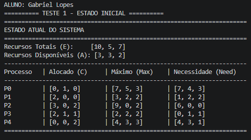
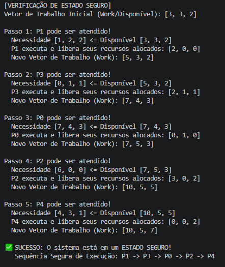
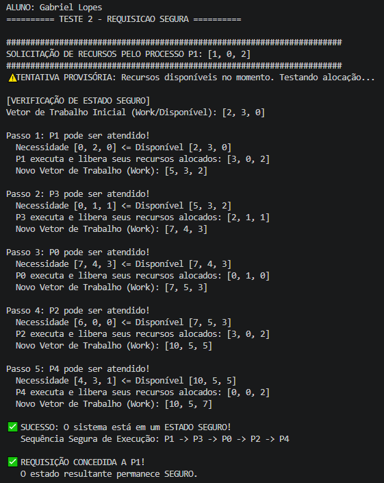
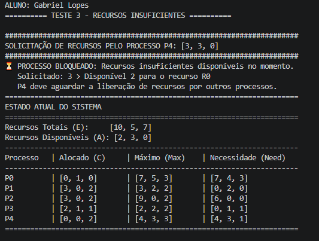
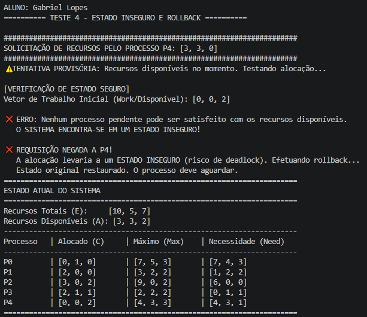

# Atividade 07
# Atividade 07 — Algoritmo do Banqueiro

**Aluno:** Gabriel Lopes  
**Disciplina:** Sistemas Operacionais  
**Linguagem de programação:** Python  
**Tema:** Algoritmo do Banqueiro — Prevenção de Deadlocks

---

## 1. Introdução

O Algoritmo do Banqueiro, desenvolvido por Edsger Dijkstra, é uma técnica utilizada em Sistemas Operacionais para evitar situações de deadlock (impasse) durante a alocação de recursos entre processos.

Seu funcionamento consiste em analisar as solicitações de recursos e verificar se a concessão de uma determinada requisição manterá o sistema em um estado seguro.

Um estado é considerado seguro quando existe pelo menos uma sequência de execução que permite que todos os processos sejam finalizados sem entrar em deadlock.

Nesta atividade, foi utilizado um simulador desenvolvido em Python para demonstrar o funcionamento do algoritmo por meio de quatro testes, envolvendo estados seguros, requisições válidas, recursos insuficientes e estados inseguros.

## 2. Objetivo

Executar o Algoritmo do Banqueiro e analisar seu comportamento diante de diferentes solicitações de recursos.

Os testes realizados possuem os seguintes objetivos:

1. Verificar se o estado inicial do sistema é seguro.
2. Simular uma requisição válida que mantém o sistema seguro.
3. Verificar o comportamento diante de uma requisição com recursos insuficientes.
4. Demonstrar a identificação de um estado inseguro e a realização de rollback.

## 3. Configuração do Sistema

O simulador utiliza cinco processos, identificados como P0, P1, P2, P3 e P4, que compartilham três tipos de recursos: R0, R1 e R2.

### Recursos totais

| Recurso | Quantidade |
|---|---|
| R0 | 10 |
| R1 | 5 |
| R2 | 7 |

**Vetor de recursos totais:**

`E = [10, 5, 7]`

### Matriz de alocação inicial (Allocation)

| Processo | R0 | R1 | R2 |
|---|---|---|---|
| P0 | 0 | 1 | 0 |
| P1 | 2 | 0 | 0 |
| P2 | 3 | 0 | 2 |
| P3 | 2 | 1 | 1 |
| P4 | 0 | 0 | 2 |

### Matriz de necessidade máxima (Max)

| Processo | R0 | R1 | R2 |
|---|---|---|---|
| P0 | 7 | 5 | 3 |
| P1 | 3 | 2 | 2 |
| P2 | 9 | 0 | 2 |
| P3 | 2 | 2 | 2 |
| P4 | 4 | 3 | 3 |

### Matriz de necessidade restante (Need)

A matriz Need representa a quantidade de recursos que cada processo ainda poderá solicitar para concluir sua execução.

É calculada pela fórmula:

`Need = Max - Allocation`

| Processo | R0 | R1 | R2 |
|---|---|---|---|
| P0 | 7 | 4 | 3 |
| P1 | 1 | 2 | 2 |
| P2 | 6 | 0 | 0 |
| P3 | 0 | 1 | 1 |
| P4 | 4 | 3 | 1 |

O vetor inicial de recursos disponíveis é:

`Available = [3, 3, 2]`

---

## 4. Testes Realizados

### Teste 1 — Verificação do Estado Inicial

**Objetivo:** verificar se o sistema se encontra inicialmente em um estado seguro, permitindo a execução de todos os processos.

**Execução:**

O algoritmo inicia com o vetor de recursos disponíveis `[3, 3, 2]` e analisa quais processos podem ser atendidos.

Durante a execução, cada processo que consegue finalizar libera os recursos que estavam alocados a ele, aumentando a quantidade disponível para os próximos processos.

A sequência encontrada foi:

`P1 → P3 → P0 → P2 → P4`

Evolução do vetor de trabalho:

| Passo | Processo | Vetor após liberação |
|---|---|---|
| Inicial | — | [3, 3, 2] |
| 1 | P1 | [5, 3, 2] |
| 2 | P3 | [7, 4, 3] |
| 3 | P0 | [7, 5, 3] |
| 4 | P2 | [10, 5, 5] |
| 5 | P4 | [10, 5, 7] |

**Resultado obtido:**

O algoritmo identificou que o sistema está em um estado seguro, pois todos os processos podem ser finalizados seguindo a sequência encontrada.

**Saída do programa:**

```text
SUCESSO: O sistema está em um ESTADO SEGURO!
Sequência Segura de Execução: P1 -> P3 -> P0 -> P2 -> P4
```

**Evidências da execução:**

Estado inicial e matrizes:



Verificação da sequência segura:



---

### Teste 2 — Requisição Válida e Segura

**Objetivo:** verificar se uma solicitação de recursos pode ser concedida sem comprometer a segurança do sistema.

**Execução:**

O processo P1 realiza a seguinte solicitação:

`Request(P1) = [1, 0, 2]`

Inicialmente, os recursos disponíveis são:

`Available = [3, 3, 2]`

A necessidade restante do processo P1 é:

`Need(P1) = [1, 2, 2]`

A requisição respeita tanto a necessidade máxima restante quanto os recursos disponíveis.

O algoritmo realiza uma alocação provisória, atualizando o vetor de recursos disponíveis para:

`Available = [2, 3, 0]`

Em seguida, verifica novamente se o sistema permanece seguro.

A sequência segura encontrada foi:

`P1 → P3 → P0 → P2 → P4`

**Resultado obtido:**

A solicitação foi concedida porque o sistema permaneceu em um estado seguro após a alocação.

**Saída do programa:**

```text
SUCESSO: O sistema está em um ESTADO SEGURO!
Sequência Segura de Execução: P1 -> P3 -> P0 -> P2 -> P4

REQUISIÇÃO CONCEDIDA A P1!
O estado resultante permanece SEGURO.
```

**Análise:**

O teste demonstra que o Algoritmo do Banqueiro permite a concessão de recursos quando existe uma sequência segura de execução após a alocação.

**Evidência da execução:**



---

### Teste 3 — Requisição com Recursos Insuficientes

**Objetivo:** verificar como o algoritmo se comporta quando um processo solicita mais recursos do que estão disponíveis no momento.

**Execução:**

Após a concessão dos recursos ao processo P1, o vetor de recursos disponíveis é:

`Available = [2, 3, 0]`

O processo P4 solicita:

`Request(P4) = [3, 3, 0]`

Ao comparar a solicitação com os recursos disponíveis, o algoritmo identifica que P4 solicita três unidades do recurso R0, enquanto apenas duas unidades estão disponíveis.

**Resultado obtido:**

A requisição foi bloqueada por insuficiência de recursos.

**Saída do programa:**

```text
PROCESSO BLOQUEADO: Recursos insuficientes disponíveis no momento.
Solicitado: 3 > Disponível 2 para o recurso R0
P4 deve aguardar a liberação de recursos por outros processos.
```

**Análise:**

O teste demonstra que o algoritmo impede a alocação quando não existem recursos suficientes para atender à solicitação.

Nesse caso, não é necessário realizar uma nova verificação de estado seguro, pois a requisição já falha na etapa de disponibilidade.

O vetor de recursos disponíveis permanece inalterado:

`Available = [2, 3, 0]`

**Evidência da execução:**



---

### Teste 4 — Requisição Insegura e Rollback

**Objetivo:** demonstrar que o Algoritmo do Banqueiro pode negar uma requisição mesmo quando existem recursos suficientes, caso a alocação resulte em um estado inseguro.

**Execução:**

Para este teste, foi criada uma nova instância do simulador, restaurando as condições iniciais do sistema.

Os recursos disponíveis inicialmente são:

`Available = [3, 3, 2]`

O processo P4 solicita:

`Request(P4) = [3, 3, 0]`

A solicitação respeita a necessidade máxima do processo e os recursos disponíveis.

O algoritmo realiza uma alocação provisória, deixando o sistema com:

`Available = [0, 0, 2]`

Entretanto, ao executar a verificação de segurança, o algoritmo identifica que nenhum dos processos pendentes consegue finalizar com os recursos restantes.

Dessa forma, o sistema entraria em um estado inseguro.

**Resultado obtido:**

O algoritmo negou a requisição e realizou um rollback, desfazendo a alocação provisória.

**Saída do programa:**

```text
ERRO: Nenhum processo pendente pode ser satisfeito
com os recursos disponíveis.

O SISTEMA ENCONTRA-SE EM UM ESTADO INSEGURO!

REQUISIÇÃO NEGADA A P4!
A alocação levaria a um ESTADO INSEGURO
(risco de deadlock). Efetuando rollback...

Estado original restaurado.
O processo deve aguardar.
```

Após o rollback, o vetor de recursos disponíveis retornou ao seu valor original:

`Available = [3, 3, 2]`

**Análise:**

Este teste demonstra uma das principais características do Algoritmo do Banqueiro: a capacidade de avaliar não apenas a disponibilidade imediata dos recursos, mas também a segurança do estado resultante.

Embora a requisição pudesse ser atendida inicialmente, sua concessão impediria a conclusão dos processos com os recursos disponíveis.

O rollback garantiu que a alocação provisória fosse desfeita, preservando o estado seguro anterior.

É importante destacar que um estado inseguro não significa necessariamente que ocorreu um deadlock, mas que o sistema não consegue garantir uma sequência segura de execução.

**Evidência da execução:**



---

## 5. Resumo dos Resultados

| Teste | Situação | Resultado |
|---|---|---|
| 1 | Verificação do estado inicial | Estado seguro |
| 2 | P1 solicita [1, 0, 2] | Requisição concedida |
| 3 | P4 solicita [3, 3, 0] após o Teste 2 | Processo bloqueado |
| 4 | P4 solicita [3, 3, 0] no estado inicial | Requisição negada e rollback realizado |

Os resultados demonstram que o algoritmo consegue identificar estados seguros, conceder recursos quando possível, bloquear requisições por insuficiência de recursos e impedir alocações que comprometeriam a segurança do sistema.

## 6. Como Executar

O programa foi desenvolvido em Python e utiliza apenas bibliotecas da própria linguagem, não sendo necessária a instalação de dependências externas.

Para executar o simulador, abra um terminal na pasta `atividade-07` e utilize:

```bash
python banqueiro.py
```

Caso necessário, no Windows:

```bash
py banqueiro.py
```

O programa executará automaticamente os quatro testes e exibirá no terminal as matrizes, os recursos disponíveis, as verificações de segurança e os resultados das requisições.

## 7. Conclusão

A realização desta atividade permitiu compreender o funcionamento do Algoritmo do Banqueiro e sua importância para o gerenciamento seguro de recursos em Sistemas Operacionais.

Por meio dos quatro testes, foi possível observar diferentes comportamentos do algoritmo.

No primeiro teste, o sistema apresentou um estado seguro, permitindo a finalização de todos os processos.

No segundo, uma requisição válida foi concedida, pois a alocação não comprometeu a segurança do sistema.

No terceiro, a solicitação foi bloqueada devido à quantidade insuficiente de recursos disponíveis.

Por fim, no quarto teste, o algoritmo identificou que uma alocação provisória levaria o sistema a um estado inseguro, negando a requisição e restaurando o estado original por meio de rollback.

Conclui-se que o Algoritmo do Banqueiro é uma técnica importante para evitar deadlocks, pois analisa antecipadamente as consequências das solicitações de recursos e permite apenas as alocações que preservam um estado seguro.

## 8. Referência

TANENBAUM, Andrew S.; BOS, Herbert. **Sistemas Operacionais Modernos**. Capítulo 6.

Material e código-base disponibilizados na disciplina de Sistemas Operacionais.

